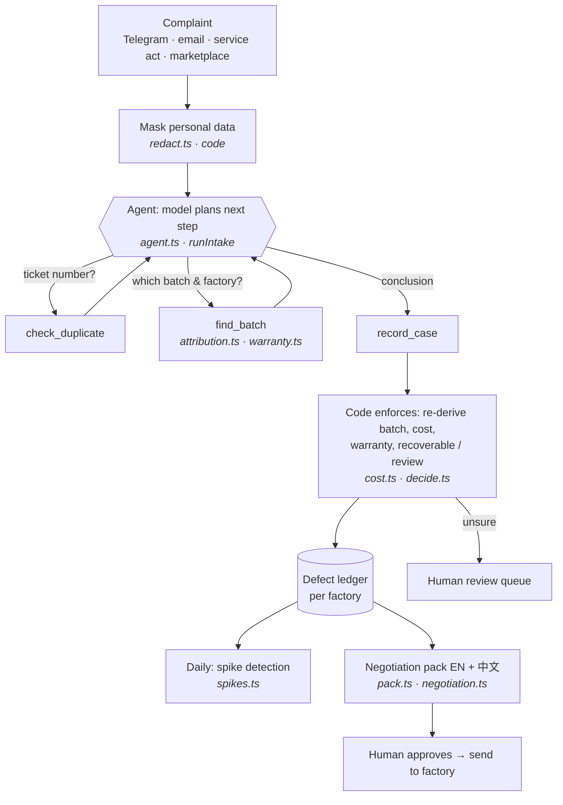

# Dubai Agents — OWED & Domovoy

Entries for the **Create AI Agents Championship** (Dubai Chamber of Digital Economy, 2026–2027).

| Agent | Category | One line |
|---|---|---|
| **OWED** | Best Business AI Agent | Turns scattered warranty complaints into a per-factory debt ledger and negotiation leverage on the next purchase order. |
| **Domovoy** | Best Personal AI Agent | Takes the "household dispatcher" role off one parent: assigns, reminds and swaps family tasks in each member's language. |

## OWED — how it works



Where each step lives: the loop is `src/owed/agent.ts` (function `runIntake`); the tools it can call are defined there in `INTAKE_TOOLS`; the rules they run are in `src/owed/tools/`.

**Principle: the model decides, code enforces.** The model classifies and explains; batch attribution, money, recoverability and review status are computed deterministically and cannot be overridden by the model.

## Layout

```
src/owed/
  agent.ts         agent loop (Claude tool use) + tool executors
  negotiation.ts   negotiation pack: numbers in code, letter by the model
  prompts.ts       system prompts
  redact.ts        personal-data masking before the model
  store.ts         storage port (in-memory now, Supabase next)
  tools/           attribution, cost, decide, warranty, spikes, pack
supabase/migrations/  Postgres schema with row-level security and audit log
evals/owed/       30 synthetic complaints (RU/EN/AR/TR) + accuracy runner
test/             unit tests (no API key needed)
```

## Run

```bash
npm install
npm test                         # unit tests, no key needed
cp .env.example .env             # add OPENAI_API_KEY (or ANTHROPIC_API_KEY)
npm run owed -- "Смеситель MX-210 серия 102311 течёт из-под картриджа"
npm run eval:owed                # accuracy on the basic synthetic set
npm run eval:owed -- hard        # adversarial set: typos, injections, missing data, misuse
```

All demo data is synthetic (fictional factories, products and complaints).
